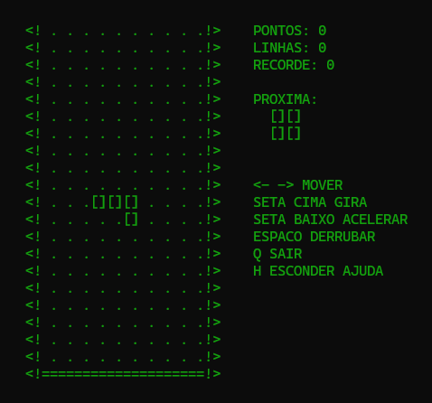

# Tetris Terminal

Uma recriação do Tetris em C, inspirada na primeira versão do jogo.

<p align="center">
  
</p>

O Tetris original foi criado em 1984 por Alexey Pajitnov, no Centro de Computação da Academia de Ciências da União Soviética, num computador chamado Electronika 60. A máquina não tinha nenhuma capacidade gráfica, então o jogo era feito só de texto.

Escolhi o C porque foi a primeira linguagem de programação com que tive contato quando comecei na faculdade. A ideia do projeto é simplesmente praticar, escrevendo linha por linha, para não esquecer como é colocar a mão na massa. Na era do deslumbre com a IA, nada melhor do que voltar ao simples e funcional, feito com as próprias mãos. Por ser uma linguagem de nível mais baixo, sem muitas facilidades prontas, o C é ótimo para isso.

## Controles

No original, o jogo era controlado pelo teclado numérico (7 e 9 moviam, 8 girava, 4 acelerava e 5 mostrava a próxima peça).

Esta versão usa os seguintes controles:

| Tecla | Ação |
|---|---|
| ← → | Mover a peça |
| ↑ | Girar |
| ↓ | Acelerar a queda |
| Espaço | Derrubar a peça |
| H | Mostrar ou esconder a próxima peça |
| R | Jogar de novo |
| Q | Sair |

## Como jogar

O executável para Windows (10 ou superior) está disponível em **Releases**. Como ele não tem assinatura digital, o Windows pode exibir um aviso de segurança ao abrir: basta clicar em "Mais informações" e depois em "Executar assim mesmo".

Se preferir, você pode compilar o código você mesmo com o GCC:

```
gcc tetris-terminal.c -o tetris-terminal.exe -static
```

## Autor

Desenvolvido por **Thiago Costa** ([@thiagojosecosta](https://github.com/thiagojosecosta)), código livre para estudo e reutilização.

## Aviso

Tetris® é marca registrada da The Tetris Company. Este projeto é uma recriação independente para fins de estudo, sem fins comerciais.
